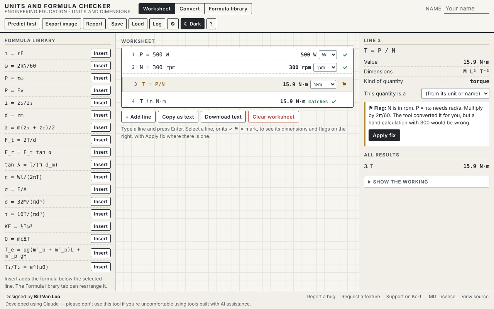

# Units and Formula Checker

A browser worksheet for calculations with units. Students write a calculation the way they would on paper, one line at a time, with a unit on every number. The tool tracks the physical dimensions through each step, converts units, flags steps that cannot be right, and names the common mistakes: mixing N·mm with N·m, using rpm where rad/s belongs, or adding quantities that are not the same kind.

Part of **[Engineered by the Numbers](https://github.com/billvanloo/EngineeredByTheNumbers)**, a Principles of Engineering unit (all modules; supplements S1, units, and S2, rearranging formulas).



## Quick start

**Online:** enable GitHub Pages for this repo (Settings → Pages → Deploy from a branch → `main`, `/ (root)`) and share the URL.

**Offline:** download `index.html` and open it in any current browser. It's one self-contained file with no network calls, and works on a Chromebook.

## What students do

- **Worksheet.** Type a line and press Enter:
  - a given: `P = 500 W`
  - a step: `T = P/omega`
  - a check: `T in N·m`
  - a conversion: `100 lbf·in in N·m`

  Each line shows its value in a unit chosen from a dropdown of compatible units, and a mark: ✓ no flags, ℹ a note, ⚑ a likely mistake, ✗ no value. Select a line to see its dimensions, its kind of quantity, and an explanation of each flag, with **Apply fix** where there is one.
- **Flags.**
  - Adding unlike quantities (✗).
  - A length inside tan or exp (✗).
  - rpm used where rad/s is needed (⚑, with a fix that inserts ω = 2πN/60).
  - Degrees inside e^(μθ) (ℹ, converted).
  - A torque added to an energy (⚑).
  - An absolute temperature in Q = mcΔT (⚑).
  - A percent used as a fraction (ℹ).
  - Mixed mm and m in a stress (ℹ, converted).
  - A check that asks for the wrong kind of unit (✗, with a fix).
- **Convert tab.** Quick conversions, worked examples, and the exact definitions every conversion is built from.
- **Formula library.** The unit's 18 formulas with their sources. **Insert** adds one to the worksheet. **Rearrange** solves for any variable that appears once, one step at a time, and says so plainly when a variable appears more than once.
- **Predict first.** Every worked-out line hides its value until the student predicts it and presses Check, so a hand calculation can be compared line by line. Every attempt goes to the prediction log.
- **Saving and exports.** Save and Load the worksheet; copy it as text or download a `.txt` file for a calc sheet; export a PNG of the worksheet; print a report with the worksheet, flags and working.
- **Accessibility.** Each line's result and any flag is announced to screen readers when the student presses Enter.

## Teacher notes

- **Units known:**
  - length: m, mm, cm, km, µm, in, ft
  - mass: kg, g, lb
  - force: N, kN, mN, lbf, ozf, kgf
  - torque: N·m, N·mm, N·cm, lbf·in, lbf·ft, ozf·in, kgf·cm
  - pressure and stress: Pa, kPa, MPa, GPa, psi, ksi, N/mm²
  - energy: J, kJ, ft·lbf
  - power: W, kW, hp
  - speed and rotation: m/s, mm/s, ft/min, rpm, rev/s, rad/s, deg/s
  - angle: rad, deg, rev
  - time: s, min, h
  - temperature change: °C, K
  - and units built from these with ·, *, /, ^ and spaces.

  Every conversion factor is built from spec 06 §3.3's exact definitions, which the help panel and the Convert tab list.
- **How ambiguous input is read** (QUESTIONS Q24 to Q25 and Q36):
  - A unit is read only right after a number. So in `0.5*m*v^2` the m is a variable, `5 m` is 5 metres, and `g` on its own is 9.81 m/s².
  - A space before `*` or `/` ends a unit, so `2 kg * g` is 2 kg times g.
  - `2*pi*N/60` with N in rpm is read as the rpm-to-rad/s conversion.
  - A °C value given to a name that doesn't start with d or Δ is an absolute temperature.
- **Not in version 1:** algebra beyond rearranging where the unknown appears once, calculus, and uncertainty.

## How it connects to the other tools

| File | Direction |
|---|---|
| `prediction-log` JSON/CSV | **Out**, to the Prediction Log Collector (quantity = the line's variable name) |

## Development

```
node dev/test.js          # 119 checks: every spec test case UF-1 to UF-14, the parser rules, §3.3, each detector, the library and rearranging
node dev/verify-html.js   # inline code in index.html matches dev/core.js and dev/vendor/; runs spec cases on it
node dev/e2e.js           # 92 browser checks in headless Chromium (needs Playwright, see below)
```

- **Where the code lives.** `dev/core.js` holds the units table, the parser, the evaluator with its detectors, display units, fixes, the formula library and the rearrange helper. `dev/vendor/` holds the shared Engineered by the Numbers tool shell, prediction log and file schemas. Don't edit vendored files here. Change them in the EngineeredByTheNumbers repo and run its `scripts/sync-vendor.js`.
- **Changing the core.** Edit `dev/core.js`, run `node dev/test.js`, then `node dev/verify-html.js --fix` to copy it into `index.html`.
- **Playwright for the e2e checks.** It isn't a project dependency. Once, from the repo root: `npm i --no-save playwright && npx playwright install chromium`. You can also set `CHROMIUM_PATH` to an installed Chromium.

The spec this tool was built from is in [`docs/spec.md`](docs/spec.md), with the shared conventions in [`docs/conventions.md`](docs/conventions.md).

This was built using Claude. Please don't use this tool if you have qualms about using code created with AI tools.
